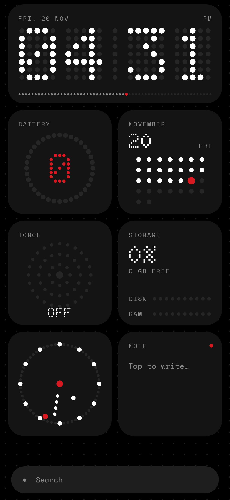

# Dot Launcher

Nothing-phone jaisa minimal, dot-matrix style Android launcher. Kaala background, dot grid, monochrome icons aur red accent.



## Install
1. `release/DotLauncher-v1.1.apk` phone me download karo aur install karo ("Unknown sources" allow karna padega).
2. Home button dabao → **Dot Launcher** chuno → "Always".
   (Ya app ke Settings → *Set as default launcher*.)

## Features
**Home widgets (dot-matrix style)**
- Dot clock: bada LED-matrix time, blinking colon, seconds ki dot-line
- Battery: dots ki ring, low battery par red, charging par ghoomta dot
- Calendar: mahine ka har din ek dot (aaj red)
- Torch: ek tap me flashlight on/off
- Storage & RAM: dot bars
- Analog dot clock
- Quick note: home par sticky note
- Android ke koi bhi widgets bhi add kar sakte ho (home par long-press → Add widget)
- Widget long-press → hide; Settings se on/off

**Dusre launchers ke liye widgets:** "Dot Clock" aur "Dot Date" widgets kisi bhi launcher me milenge.

**App drawer**
- Upar swipe karo ya Search pill dabao
- Search (naam ya initials se, e.g. "gm" → Google Maps); Enter = pehla app ya web search
- Sabse zyada use hone wale 5 apps top par
- App long-press: dock me add/remove, App info, Hide, Uninstall
- Work profile apps bhi dikhte hain

**Aur**
- Monochrome icons (Android 13+ themed icons, warna grayscale)
- Dock: max 5 apps (pehli baar Phone/Messages/Browser/Camera)
- Double-tap = screen lock (pehli baar "Allow" dabana hoga — sirf screen lock ki permission. Uninstall se pehle Settings me ise OFF karein)
- Neeche swipe = notifications
- Accent color: Red / White / Yellow / Green / Blue
- 24h clock, seconds, drawer columns (3–6), app names, haptics, hidden apps

## Build
```
./gradlew assembleRelease     # APK: app/build/outputs/apk/release/
./gradlew testDebugUnitTest   # screenshots/ me UI render karta hai
```
Android SDK 34, JDK 17+. Release APK debug key se signed hai (Play Store ke liye apni key lagayein).

## Fonts
Doto aur Space Mono — dono SIL Open Font License ke tahat (Google Fonts).
Ye ek independent app hai, Nothing Technology se juda nahi hai.
