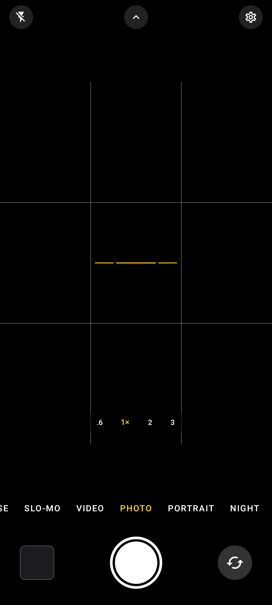
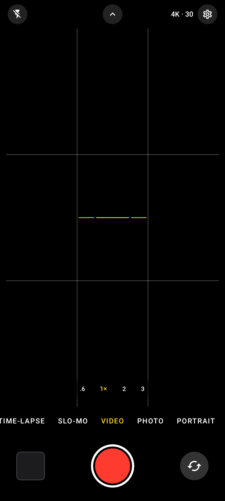
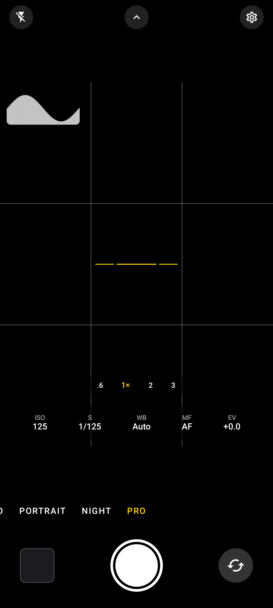
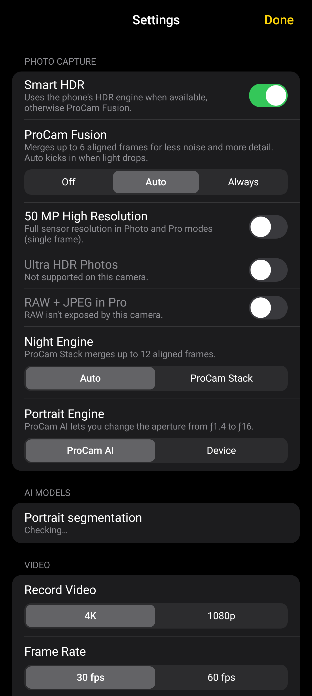

# ProCam: a pro camera app for the Moto Edge 60 Pro

ProCam has an iPhone-style interface and an English UI, and adds its own computational-photography pipeline on top of what the phone's hardware provides.

**Install:** copy `release/ProCam-v1.0.apk` to the phone, open it, and allow "Install unknown apps".
On first launch, allow Camera and Microphone. The AI portrait model then downloads automatically through Google Play services.

| Photo | Video | Pro | Settings |
|---|---|---|---|
|  |  |  |  |

## Modes
| Mode | What it does |
|---|---|
| **PHOTO** | Smart HDR (the phone's HDR engine), **ProCam Fusion** (merges up to 6 aligned frames when light drops), 50 MP mode, Ultra HDR, QR scanning, and burst (hold the shutter). |
| **PORTRAIT** | AI subject segmentation (Google's on-device model), a lens-like bokeh blur in linear light, and an adjustable aperture from **ƒ1.4 to ƒ16**. |
| **NIGHT** | Uses Motorola's Night engine when available. Otherwise **ProCam Stack** merges up to 12 frames and applies low-light boost and longer exposures. |
| **PRO** | Manual ISO, shutter (1/8000 to 30"), white balance, manual focus and EV, a live histogram, and **RAW (DNG) + JPEG**. |
| **VIDEO** | 4K or 1080p, 30 or 60 fps, 10-bit HLG HDR, stabilization, and a high bitrate (up to 120 Mbps). |
| **SLO-MO** | 120 or 240 fps high-speed capture (CameraX high-speed session). |
| **TIME-LAPSE** | Records, then speeds the clip up 5× to 60× on the phone (Media3 Transformer). |

## iPhone-style controls
- Lens pills (.6 / 1× / 2 / 3), pinch to zoom, and a swipe across the viewfinder to change mode.
- Tap to focus shows a yellow box. Drag up or down to change exposure (sun slider). Long-press for **AE/AF LOCK**.
- A tray (chevron) for aspect ratio (4:3, 16:9, 1:1), a 3s or 10s timer, exposure, Photographic Styles, and grid.
- Photographic Styles: Rich Contrast, Vibrant, Warm, Cool, Cinematic, Noir and Mono. They show live in the viewfinder and are applied to the saved photo.
- Level indicator, grid, front-camera screen flash, mirrored selfies, the volume buttons as a shutter, haptics, and rotating icons.

## How ProCam Fusion / Night Stack works (`Processing.kt`)
1. A burst of JPEG frames is kept compressed, so memory use stays low.
2. A coarse-to-fine alignment finds a global shift on a 1/16 and 1/4 pyramid, then refines it per 64 px tile, which corrects hand shake.
3. A robust merge weights every pixel by how well it matches the reference frame. The rejection threshold adapts to the frame's measured noise, so moving objects don't ghost.
4. Tone mapping applies exposure gain, extended-Reinhard highlight roll-off and shadow lift, then saturation and an unsharp mask.

The unit tests (`app/src/test`) check the result on synthetic hand-held bursts:
- Noise drops **2.3× with 6 frames** (the theoretical maximum is 2.45×).
- Moving objects don't ghost.
- Night frames are brightened.

## Build
```
./gradlew :app:assembleRelease    # APK -> app/build/outputs/apk/release
./gradlew :app:testDebugUnitTest  # pipeline tests + UI screenshots (app/build/screens)
```
The build uses Kotlin, Jetpack Compose, CameraX 1.7, Media3 and ML Kit, with minSdk 29 and targetSdk 36.
